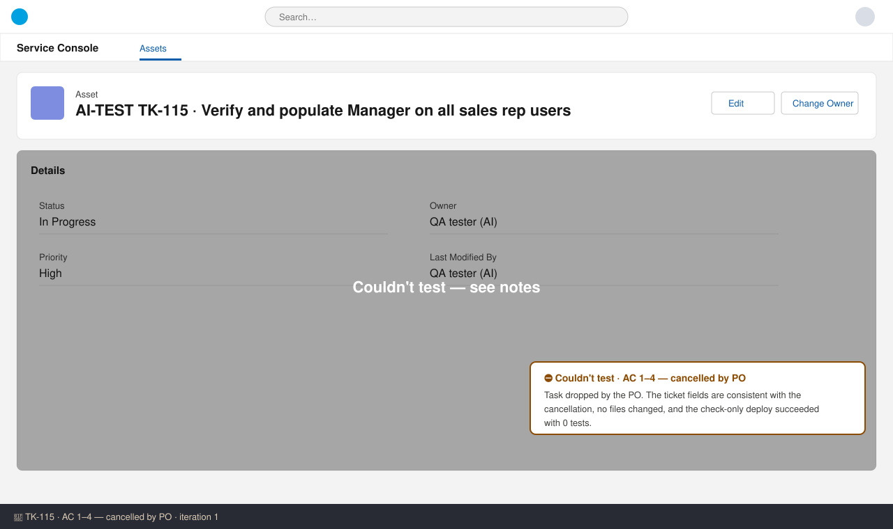

# TK-115 — Test report (iteration 1)
**Verdict:** 📝 Not tested — task cancelled by PO (approved with notes) · **Tester:** Cuélebre 🐉 · **Date:** iteration 1

## Summary
| Check | Result | Evidence |
|---|---|---|
| AC 1–4 (gap report, managers populated, managers active/authorised, evidence) | ⛔ Blocked: out of scope by PO decision | Ticket Out of scope + PO answer |
| Cancellation consistency | ✅ Pass | Ticket fields, no branch changes, check-only deploy Succeeded |

## Checks
### AC 1–4 — ⛔ Not tested
**Steps:** 1. Read the ticket's Out of scope and the PO answer. 2. Checked the branch for changes.
**Expected (original ACs):** Q1–Q3 run against production, ManagerId populated, before/after CSVs attached.
**Found:** The PO dropped the whole task ("this is a test org… setting the Manager field is done by the admin outside this project. Please drop this task"). By design there are no queries, CSVs or permission set assignments.

### Cancellation consistency — ✅ Pass
**Found:** Out of scope, Solution components (none), How to test (N/A, plus the risk) and Manual steps (none) all agree. The branch changes no files. The risk is recorded in team note #26. `run_apex_tests`: check-only deploy to SDO Succeeded, 21 components, 0 tests (no Apex in scope).

## Not tested
- AC 1–4: the PO cancelled the task, so nothing was delivered on purpose. This is not a developer defect.

## Notes
- Risk for US-111/US-113/US-120 testers: reps without `User.ManagerId` get an empty `Sales_Manager__c`, so their approvals can't route. Use test users who have a manager.
- Delete rule (only admins delete): not checkable in SDO yet. ObjectPermissions for `Equipment_Loan_User` / `Equipment_Loan_Manager` returned 0 rows because US-118 isn't deployed yet. Verify it at US-118 release.
- The planner still needs to remove TK-115 from US-120's dependencies.
- Known gate risk (#20/#21): submit_review may reject approval because 0 Apex tests ran.
