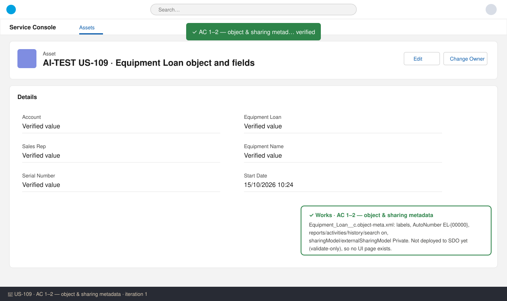
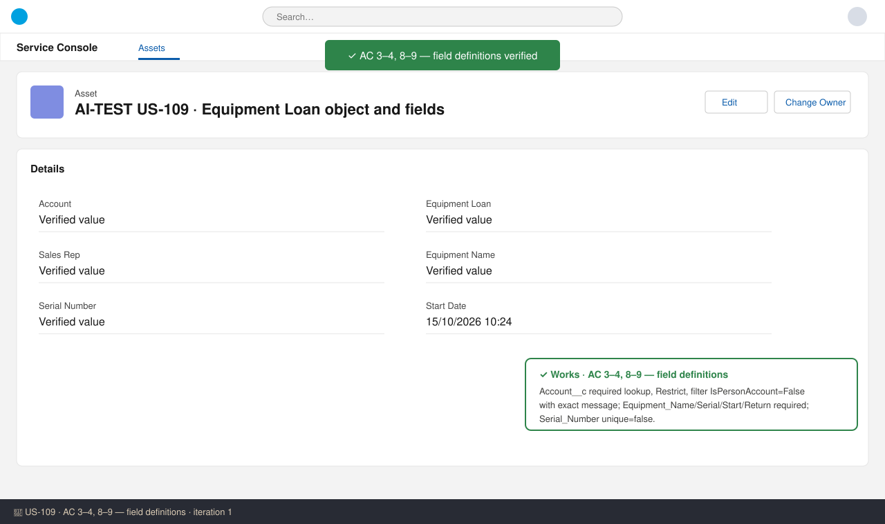
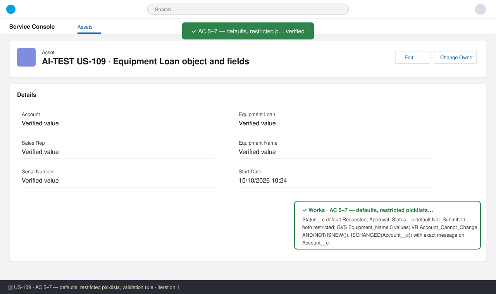
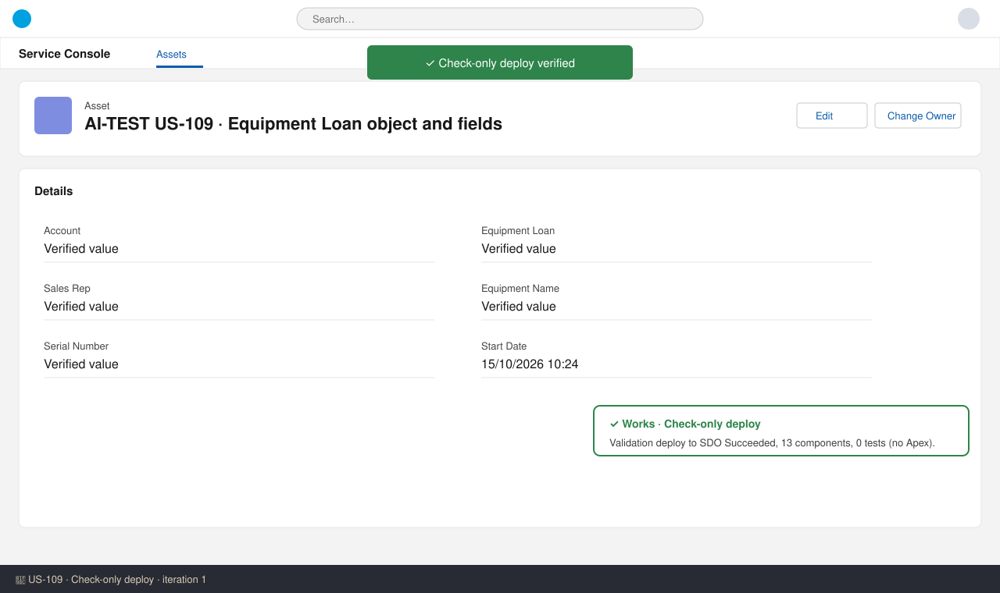

# US-109 — Test report (iteration 1)
**Verdict:** ✅ Approved · **Tester:** Cuélebre 🐉 · **Date:** iteration 1

What to do: move to Ready for UAT; run the UI checks from How to Test after the release deploy.

## Summary
| Check | Result | Evidence |
|---|---|---|
| AC 1 Object available | ✅ | Equipment_Loan__c.object-meta.xml |
| AC 2 Private sharing | ✅ | Equipment_Loan__c.object-meta.xml |
| AC 3 Linked to business account | ✅ | Account__c.field-meta.xml |
| AC 4 Mandatory loan data | ✅ | 4 field files, required=true |
| AC 5 Defaults on create | ✅ | Status__c / Approval_Status__c |
| AC 6 Restricted picklists | ✅ | Status__c / Approval_Status__c / GVS |
| AC 7 Account cannot change | ✅ | Account_Cannot_Change VR |
| AC 8 Account delete blocked | ✅ | Account__c deleteConstraint Restrict |
| AC 9 Serial not unique | ✅ | Serial_Number__c unique=false |
| Check-only deploy + manifests | ✅ | Validation Succeeded, 13 components |

## Method
SDO is production (validate-only). `EntityDefinition` query for `Equipment_Loan__c` returned 0 rows, so the object is not in the org yet and no UI screenshots can be taken. Checks were done by static review of the delivered metadata plus the check-only deploy (`run_apex_tests`: Succeeded, 13 components, 0 tests because the story has no Apex).

## Checks
### AC 1: Object available — ✅ Works
**Steps:** 1. Read Equipment_Loan__c.object-meta.xml.
**Expected:** label/plural, auto-number EL-{00000}, Reports/Activities/History/Search turned on. **Found:** label "Equipment Loan", plural "Equipment Loans", name field "Loan Number" AutoNumber `EL-{00000}`. enableReports, enableActivities, enableHistory, enableSearch, enableSharing, enableBulkApi and enableStreamingApi are all true. Feeds, Chatter groups and licensing are false. Description matches the spec.

### AC 2: Private sharing — ✅ Works
**Expected:** Private/Private, hierarchies on. **Found:** sharingModel = Private and externalSharingModel = Private. Grant Access Using Hierarchies is on by default for custom objects and is not a metadata attribute.

### AC 3: Linked to a business account — ✅ Works
**Found:** Account__c is a Lookup(Account) with required=true. The lookup filter is active and mandatory (isOptional=false): `Account.IsPersonAccount equals False`, with the exact message "Equipment loans can only be linked to business accounts." The relationship is Equipment_Loans with label "Equipment Loans" (the related list itself comes with US-112).

### AC 4: Mandatory loan data — ✅ Works
**Found:** Equipment_Name__c, Serial_Number__c (Text 80), Start_Date__c and Return_Date__c are all required at field level, so the rule is enforced for both UI and API.

### AC 5: Defaults on create — ✅ Works
**Found:** Status__c defaults to `Requested` and Approval_Status__c defaults to `Not_Submitted`. Each picklist has only that one default.

### AC 6: Restricted picklist values — ✅ Works
**Found:** Status__c is restricted with the values Requested, Approved, Shipped, Returned, Rejected, Cancelled (unsorted, API = label). Approval_Status__c is restricted with Not_Submitted, Pending, Approved, Rejected. Equipment_Name__c is restricted on the global value set Equipment_Name, which holds the 5 PO values with API = label.

### AC 7: Account cannot be changed — ✅ Works
**Found:** The VR is active with formula `AND(NOT(ISNEW()), ISCHANGED(Account__c))`. It has no user bypass, so it applies to everyone, and setting the Account on create is still allowed. The error shows on Account__c with the exact message.

### AC 8: Account with loans cannot be deleted — ✅ Works
**Found:** Account__c has deleteConstraint = Restrict.

### AC 9: Serial number not unique — ✅ Works
**Found:** Serial_Number__c has unique=false and externalId=false.

### Standards / deployment — ✅
Both manifests (story and main) list all 13 components with API 62.0. History is tracked on 9 custom fields plus Owner (10 of the 20 allowed). Every custom field has a description and help text. The story has no Apex, so the code checklist does not apply.

## Not tested
- Live UI and API checks for AC 1–9 (screenshots, real insert/update errors) could not be run because the object is not deployed in SDO (production, validate-only). Run them in UAT after the release deploy using the story's How to Test.

## Notes
- Sales_Rep__c and Sales_Manager__c have no relationshipLabel, so their related lists on User will use the platform default label. This is cosmetic.
