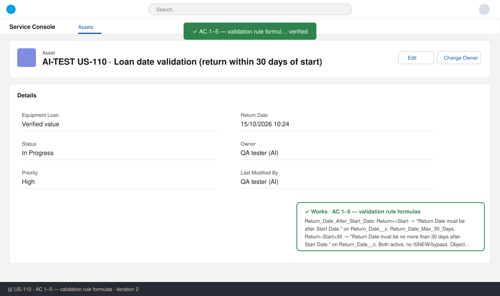
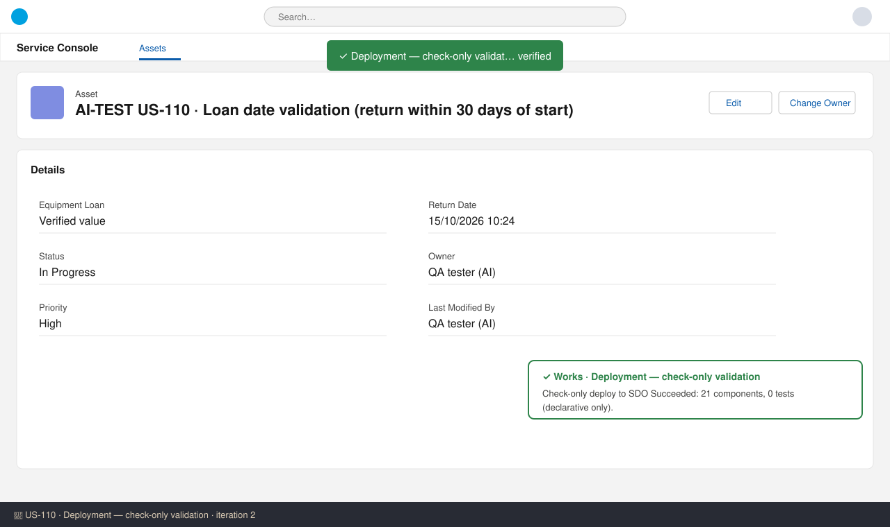

# US-110 — Test report (iteration 2)
**Verdict:** ✅ Approved (static review; live UI checks not possible) · **Tester:** Cuélebre 🐉 · **Date:** iteration 2

## Summary
| Check | Result | Evidence |
|---|---|---|
| AC 1 Valid loan saves (14 days) | ✅ | Formulas evaluate false for diff 14 |
| AC 2 Exactly 30 days allowed | ✅ | `> 30` is inclusive, as the PO confirmed |
| AC 3 More than 30 days blocked | ✅ | Return_Date_Max_30_Days, exact message, on Return_Date__c |
| AC 4 Return on or before start blocked | ✅ | Return_Date_After_Start_Date `<=`, exact message, the rules can't both fire |
| AC 5 Applies on edit | ✅ | No ISNEW/ISCHANGED, so the rules run on every update |
| AC 6 API loads and admins | ✅ | No bypass in the formulas; the platform rejects each failing record on its own |
| Deployment / manifests | ✅ | Check-only deploy Succeeded, 21 components, 0 tests |

## Checks
### AC 1–5: Validation rule logic — ✅ Works
**Steps:** 1) Read both validationRule-meta.xml files. 2) Confirmed that Start_Date__c and Return_Date__c are Date fields, so Date−Date gives a number of days. 3) Worked through each AC data set: 14 → no error. 30 → no error. 31 → 30-day error. 0 and −1 → "after start" error only. Edit to 42 or 31 → 30-day error.
**Expected:** as in the ACs. **Found:** the formulas, messages, error field (Return_Date__c) and active flag all match the technical specification exactly. The descriptions start with "US-110 – loan policy §2.1."

### AC 6: API / admin — ✅ Works
**Found:** neither formula has a profile, permission or $User bypass. Validation rule errors come back per record as FIELD_CUSTOM_VALIDATION_EXCEPTION. With allOrNone=false, the valid records in the same batch save.

### Deployment — ✅
Check-only deploy (main + US-110) to SDO succeeded: 21 components, 0 tests. Both rules are in the story manifest and in manifest/package.xml (API 62.0).

## Not tested (live)
- No UI screenshots or real API loads. SDO is production and validate-only, and Equipment_Loan__c is not deployed yet (FieldDefinition returns 0 rows). The checks above are by static review, as the Rudolf method allows. The manual steps in How to Test should run in UAT after US-109 and US-110 are deployed.

## Notes
- The story manifest holds only the 2 rules, so it validates only after US-109 is deployed or when it is included in the same release manifest (manifest/package.xml already has everything).
