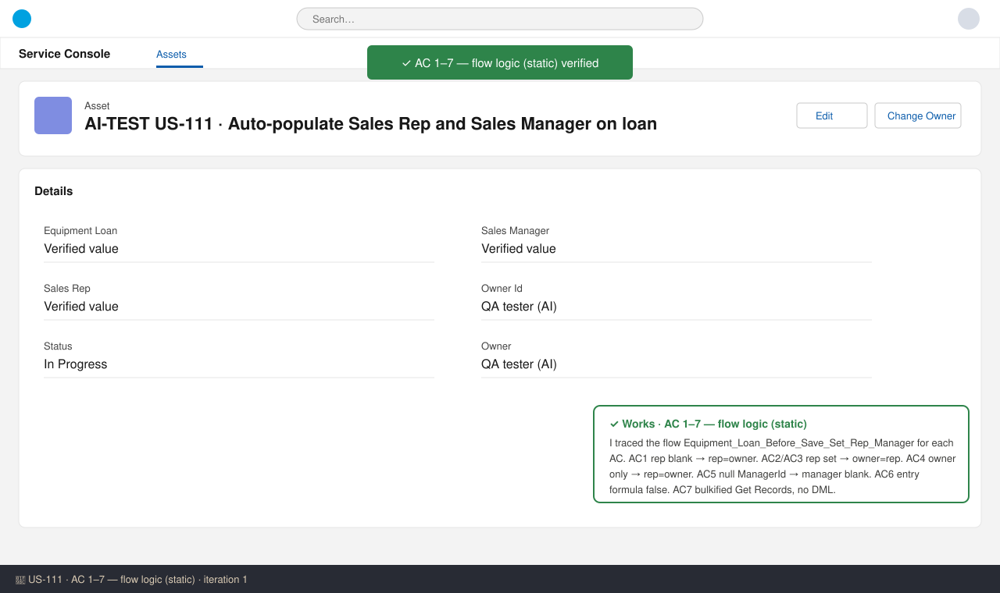
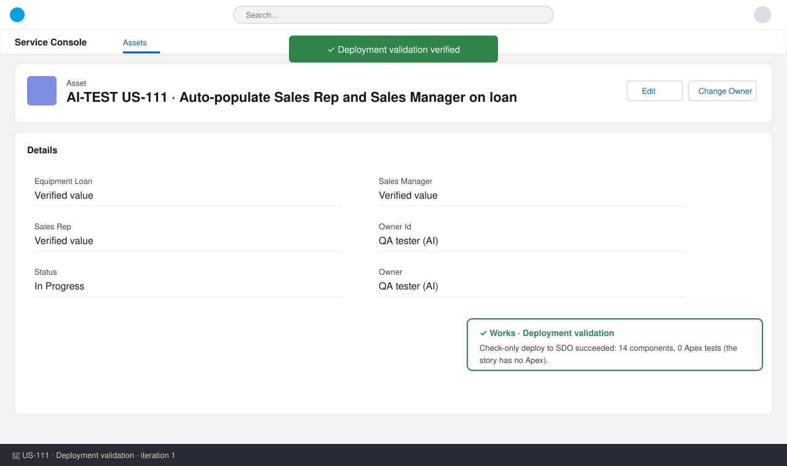
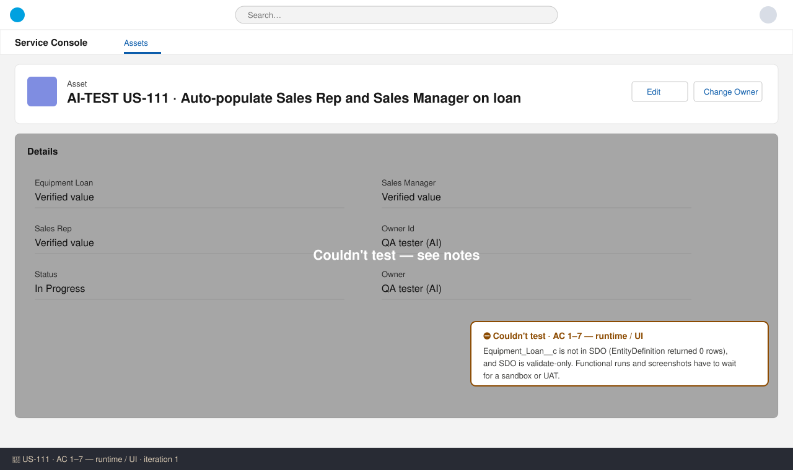

# US-111 — Test report (iteration 1)
**Verdict:** ✅ Approved with notes · **Tester:** Cuélebre 🐉 · **Date:** iteration 1

What to do: move to Ready for UAT. Run the functional checks from How to Test in a sandbox with US-109 and US-111 deployed.

## Summary
| Check | Result | Evidence |
|---|---|---|
| AC 1 Rep defaulted on create | ✅ (static) | Flow: Which_Change → Set_Rep_From_Owner → Get_Rep_User → Set_Manager |
| AC 2 Explicit rep respected | ✅ (static) | frmOwnerFromRep (ISNEW) → Set_Owner_From_Rep |
| AC 3 Rep change recalculates | ✅ (static) | ISCHANGED(Sales_Rep__c) → owner = rep, manager re-read |
| AC 4 Owner change syncs rep | ✅ (static) | AND(ISCHANGED(OwnerId), NOT(ISCHANGED(rep))) → rep = owner |
| AC 5 Rep without manager | ✅ (static) | Set_Manager assigns null ManagerId; no error path |
| AC 6 Unrelated edits | ✅ (static) | Entry formula false → flow does not run |
| AC 7 Bulk safe | ✅ (static) | Before-save, no DML, one bulkified Get Records |
| Runtime / UI for AC 1–7 | ⛔ | Equipment_Loan__c is not in SDO |
| Deployment validation | ✅ | Check-only deploy succeeded, 14 components |

## Checks
### AC 1: Rep defaulted on create — ✅ Works (static)
**Steps:** 1. Read the flow XML. 2. Traced an insert with Sales_Rep__c blank.
**Expected:** Rep = Owner = creator, Manager = creator's manager. **Found:** the entry condition ISNEW() is true. frmRepFromOwner (ISBLANK) is true, so Sales_Rep__c = OwnerId. Get_Rep_User then runs and Sales_Manager__c = ManagerId.

### AC 2: Explicit rep respected — ✅ Works (static)
**Found:** on insert, frmRepFromOwner is false (ISCHANGED is false on insert), so the flow goes to the Rep_Set_Or_Changed outcome. OwnerId = Sales_Rep__c and the manager comes from Rep B.

### AC 3: Rep change recalculates owner and manager — ✅ Works (static)
**Found:** ISCHANGED(Sales_Rep__c) is true and the owner has not changed, so OwnerId = new rep. Get Records runs after the assignment, so it returns the new rep's manager. The rep also wins when the rep and owner both change.

### AC 4: Owner change keeps rep in sync — ✅ Works (static)
**Found:** when only the owner changes, Sales_Rep__c = new OwnerId and the manager is recalculated.

### AC 5: Rep without manager — ✅ Works (static)
**Found:** a null ManagerId is assigned, so Sales_Manager__c is blank. Sales_Manager__c is not required. The custom error fires only on the Get Records fault path.

### AC 6: Unrelated edits do not recalculate — ✅ Works (static)
**Found:** the entry filterFormula `OR(ISNEW(), ISCHANGED(Sales_Rep__c), ISCHANGED(OwnerId))` is false for a Serial Number-only edit, so the flow does not run.

### AC 7: Bulk safe — ✅ Works (static)
**Found:** this is a before-save flow with no DML and no loops. Its one Get Records is bulkified by the runtime, so it costs one SOQL per batch. Rows with a blank rep take the file OwnerId or the loading user.

### Deployment / standards — ✅
The check-only deploy to SDO succeeded: 14 components, 0 tests (the story has no Apex). The flow uses API 62.0 and is Active. The flow and every element have descriptions. The fault path shows a plain-language custom error. There are no hardcoded Ids. The Flow is in both the story manifest and manifest/package.xml. The lookup filter on Sales_Rep__c (IsActive = true, UserType = Standard) enforces "active internal users only".

## Not tested
- **AC 1–7 runtime / UI screenshots:** the `EntityDefinition` query for Equipment_Loan__c returns 0 rows, so US-109 is not in SDO. SDO is also production and validate-only. The manual steps in How to Test (Rep A/B/C, Data Loader 200 rows, clear-rep edge case) must be run in a sandbox or in UAT with US-109 and US-111 deployed.

## Notes (non-blocking)
- The description-only edits to the US-109 object, fields and GVS must be reconciled at merge. Take the US-111 text (team note #18). US-109 and US-111 must ship in one release manifest.
- Style: the flow name does not follow the `{Object}_{Trigger}_{Purpose}` pattern exactly, but it matches the name in the spec.
