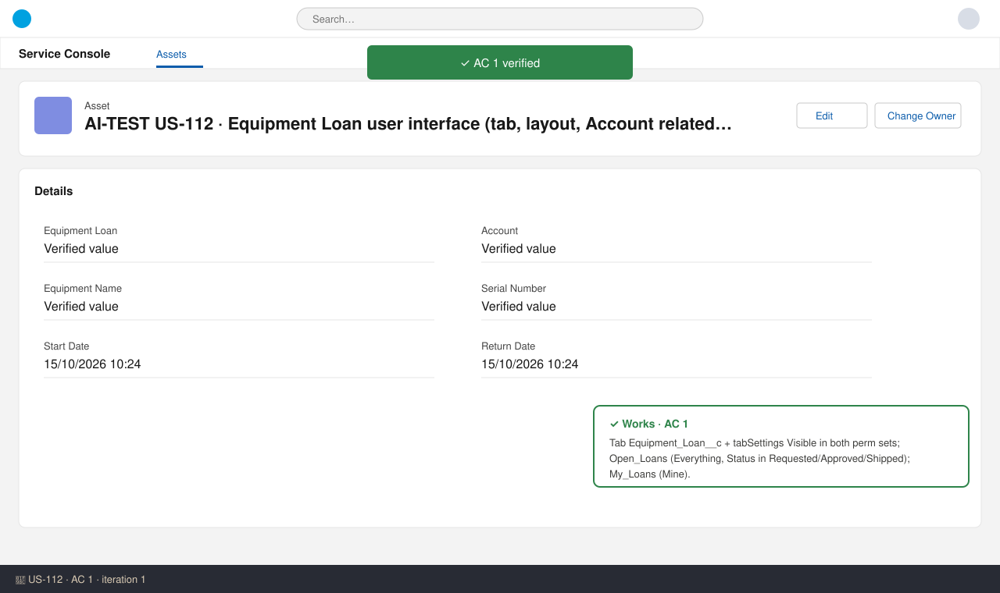
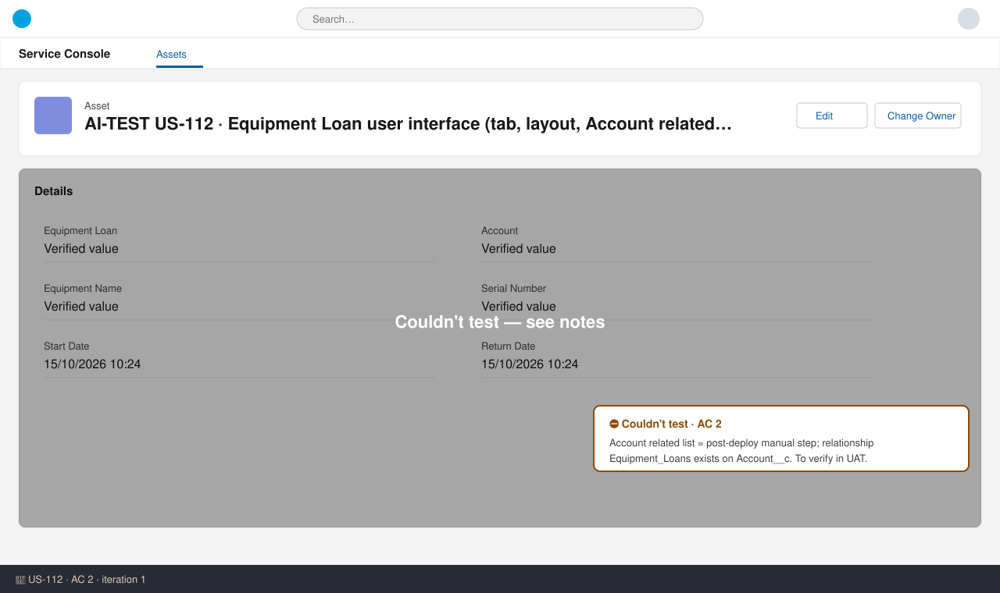
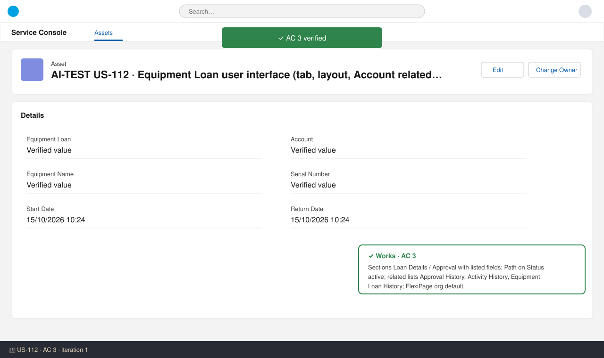
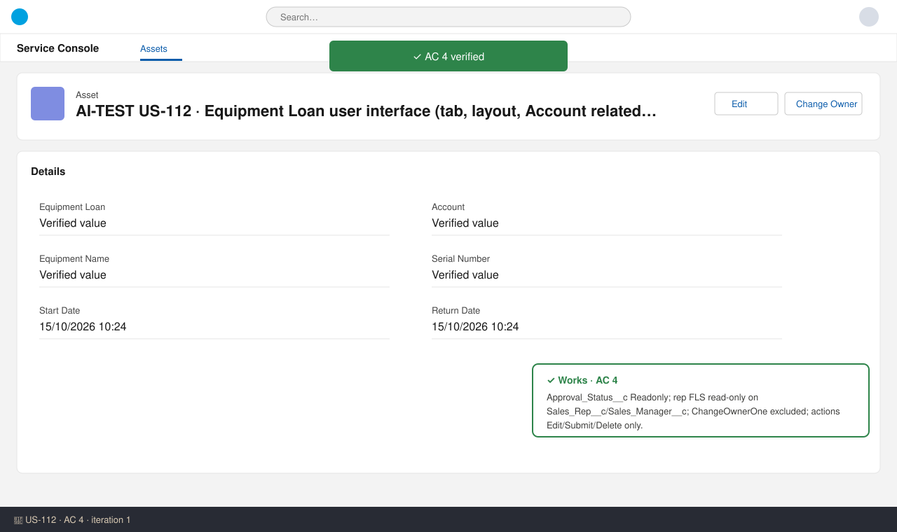
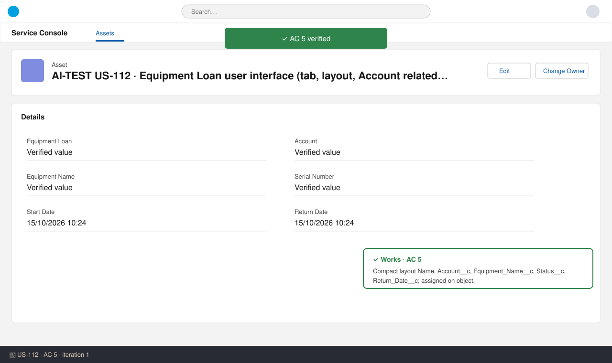

# US-112 — Test report (iteration 1)
**Verdict:** ✅ Approved with notes · **Tester:** Cuélebre 🐉 · **Date:** iteration 1

What to do: nothing for the developer. AC 2 has to be checked in UAT after release does the manual Account layout step.

## Summary
| Check | Result | Evidence |
|---|---|---|
| AC 1 Tab and list views | ✅ | Tab + tabSettings, Open_Loans / My_Loans list views |
| AC 2 Create from account | ⛔ | Post-deploy manual step, can't be checked before release |
| AC 3 Record page layout | ✅ | Layout sections, related lists, FlexiPage, PathAssistant |
| AC 4 Read-only system fields | ✅ | Layout behavior, FLS, excludeButtons, action list |
| AC 5 Compact layout | ✅ | Compact layout + assignment |
| Deployment validation | ✅ | Check-only deploy to SDO succeeded: 28 components, 0 tests (no Apex) |

**Why there are no live screenshots:** `Equipment_Loan__c` isn't in SDO yet (an EntityDefinition query returns 0 rows), because the org is production and we only validate there. The evidence below comes from static review of the branch plus the check-only deploy.

## Checks
### AC 1: Tab and list views — ✅ Works
**Steps:** 1. Read `tabs/Equipment_Loan__c.tab-meta.xml`. 2. Checked `tabSettings` in both permission sets. 3. Read both list views. 4. Confirmed no CustomApplication is in the change set.
**Expected:** the tab is visible through the loan permission sets and no app is modified. Open Loans shows Requested/Approved/Shipped across all loans the user can see. My Loans shows loans the user owns.
**Found:** the tab uses `Custom13: Box`. `Equipment_Loan_User` and `Equipment_Loan_Manager` both set `Equipment_Loan__c` to Visible. No app was changed. `Open_Loans` has filterScope `Everything`, filter `Status__c equals Requested,Approved,Shipped`, and no sharedTo, so all users can see it. `My_Loans` has filterScope `Mine`.

### AC 2: Create from account — ⛔ Not tested
**Steps:** 1. Reviewed the manual steps. 2. Read `fields/Account__c.field-meta.xml`.
**Expected:** a business Account shows an Equipment Loans related list with the listed columns, and New prefills the Account.
**Found:** the related list is added by hand after deployment (decision #23: the SDO Account layouts can't be retrieved safely). The prerequisites are in place: the `Account__c` lookup has relationshipName `Equipment_Loans` and label "Equipment Loans", with a lookup filter that allows business accounts only. Verify in UAT once the release has done the manual step.

### AC 3: Record page layout — ✅ Works
**Steps:** 1. Read the layout. 2. Read the FlexiPage. 3. Read the PathAssistant. 4. Read the object's actionOverrides.
**Expected:** sections "Loan Details" and "Approval" with the listed fields, a Path on Status, and the related lists Approval History, Activity History and Equipment Loan History.
**Found:**
- **Loan Details:** Name (Readonly), Account__c, Equipment_Name__c, Serial_Number__c, Start_Date__c, Return_Date__c, Status__c.
- **Approval:** Approval_Status__c, Sales_Rep__c, Sales_Manager__c.
- **Related lists:** RelatedProcessHistoryList, RelatedHistoryList and RelatedEntityHistoryList. The object has history and activities enabled.
- **FlexiPage:** contains pathAssistant, detailPanel and relatedListContainer. It is the org default through View / Large / Flexipage.
- **Path:** active on `Status__c` for `__MASTER__`.

### AC 4: Read-only system fields — ✅ Works
**Steps:** 1. Read the layout behaviors, excludeButtons and platformActionList. 2. Read the field permissions in both permission sets.
**Expected:** Approval Status is read-only for everyone. Reps can't edit Sales Rep or Sales Manager. There is no Change Owner action.
**Found:**
- `Approval_Status__c` is Readonly on the layout and has editable=false in both permission sets.
- `Sales_Rep__c` and `Sales_Manager__c` have editable=false in `Equipment_Loan_User`. Managers can edit them.
- `ChangeOwnerOne` is in excludeButtons, and the Lightning record actions are only Edit, Submit and Delete.

### AC 5: Compact layout — ✅ Works
**Expected:** the highlights panel shows Loan Number, Account, Equipment Name, Status and Return Date.
**Found:** `Equipment_Loan_Compact` contains Name, Account__c, Equipment_Name__c, Status__c and Return_Date__c. It is set as `compactLayoutAssignment` on the object, and the FlexiPage header uses `force:highlightsPanel`.

## Not tested
- **AC 2:** the Account related list and the Account prefill depend on the post-deploy manual step. Verify in UAT as a rep.
- **Live UI checks (AC 1, 3, 4, 5):** no screenshots because the components aren't deployed to SDO yet. Repeat the How-to-Test checks in UAT.

## Notes (no action needed)
- The story manifest doesn't list GlobalValueSet `Equipment_Name`. The branch only reformats that file, and US-109 owns it.
- The object has two View actionOverrides: Default, plus Flexipage/Large. This is the standard format and the deploy accepted it.
