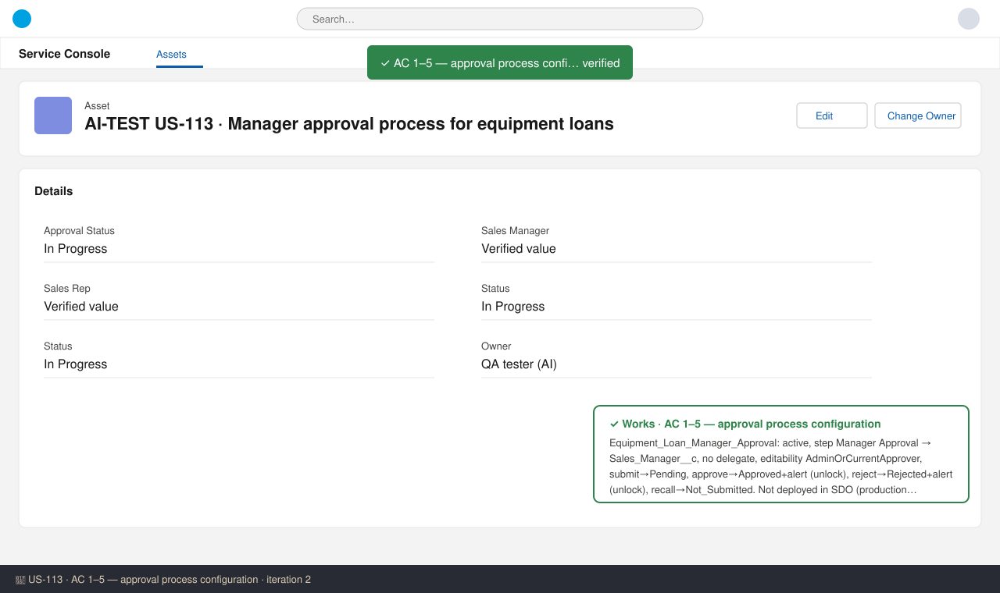
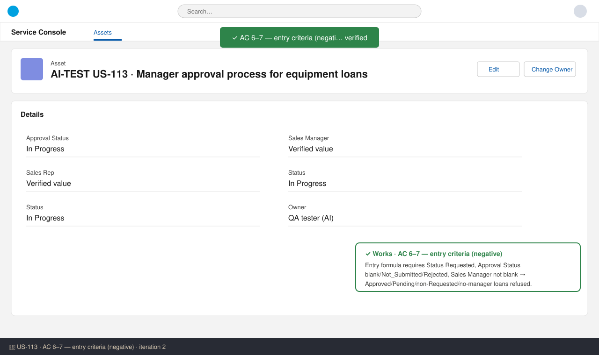
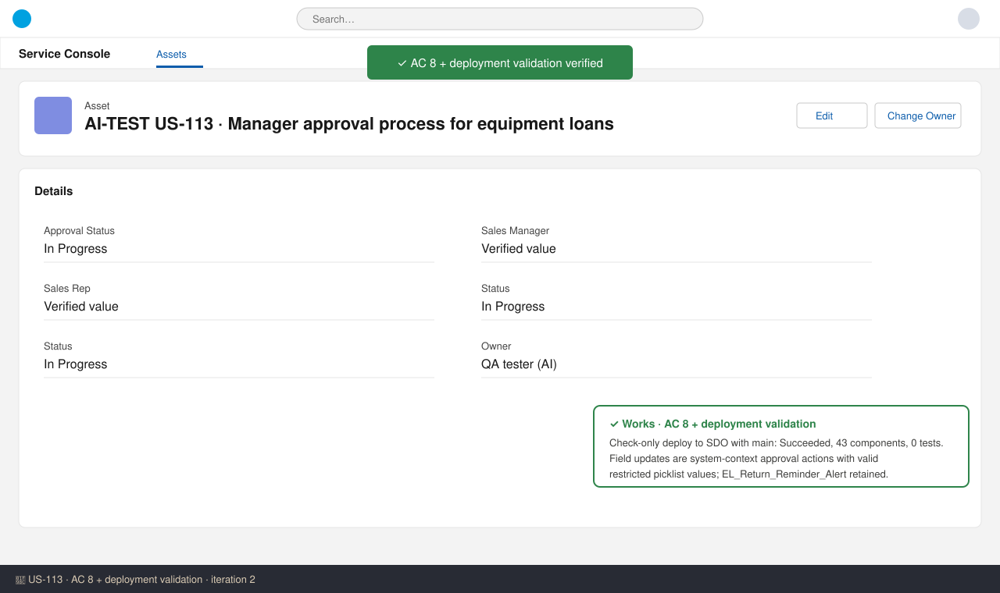

# US-113 — Test report (iteration 2)
**Verdict:** ✅ Approved (with notes) · **Tester:** Cuélebre 🐉 · **Date:** iteration 2

What to do: move to Ready for UAT. Run the runtime checks from How to Test with a rep/manager pair once the release is deployed.

## Summary
| Check | Result | Evidence |
|---|---|---|
| AC 1 Submit | ✅ | approvalProcess: step, approver, Pending update, AdminOrCurrentApprover, template subject |
| AC 2 Approve | ✅ | Approved update + approved alert, finalApprovalRecordLock=false |
| AC 3 Reject | ✅ | Rejected update + rejected alert with {!ApprovalRequest.Comments}, unlock |
| AC 4 Resubmit | ✅ | Entry criteria allow Rejected |
| AC 5 Recall | ✅ | allowRecall=true, Not_Submitted update |
| AC 6 Not eligible | ✅ | Entry formula excludes Approved, Pending, Status ≠ Requested |
| AC 7 No manager | ✅ | Entry formula requires Sales_Manager__c |
| AC 8 No VR block | ✅ | System-context field updates, valid picklist values |
| Deploy + US-116 regression | ✅ | Check-only deploy succeeded (43 components, 0 tests). EL_Return_Reminder_Alert is kept |

## Checks
### AC 1: Submit for approval — ✅ Works
**Steps:** 1. Read `Equipment_Loan__c.Equipment_Loan_Manager_Approval.approvalProcess-meta.xml`. 2. Read the approval request template and its meta file.
**Expected:** Pending status, record locked for the rep, email to the manager, step "Manager Approval" assigned to the Sales Manager. **Found:** active=true, processOrder 1. Step `Manager_Approval` (label Manager Approval) goes to relatedUserField `Sales_Manager__c`, allowDelegate=false. Initial submission runs `EL_Set_Approval_Pending`. recordEditability = AdminOrCurrentApprover. The template subject is "Equipment loan {!Equipment_Loan__c.Name} needs your approval". showApprovalHistory=true.

### AC 2: Approve — ✅ Works
**Expected:** Approved, Status stays Requested, record unlocked, email to the rep. **Found:** `EL_Set_Approval_Approved` (Literal Approved) and `EL_Loan_Approved_Alert` (userLookup Sales_Rep__c, subject "Equipment loan {Name} approved"). finalApprovalRecordLock=false. No action changes Status__c.

### AC 3: Reject — ✅ Works
**Found:** `EL_Set_Approval_Rejected` and `EL_Loan_Rejected_Alert`. The template subject is "Equipment loan {Name} rejected" and the body contains `{!ApprovalRequest.Comments}`. finalRejectionRecordLock=false.

### AC 4: Resubmit after rejection — ✅ Works
**Found:** The entry criteria accept Approval Status = Rejected. Submitting again runs the Pending update again.

### AC 5: Recall — ✅ Works
**Found:** allowRecall=true. The recall action `EL_Set_Approval_Not_Submitted` sets Not_Submitted, a valid restricted picklist API value.

### AC 6 / AC 7: Not eligible / No manager — ✅ Works
**Found:** The entry formula requires Status Requested, Approval Status blank, Not_Submitted or Rejected, and Sales Manager not blank. This is the only process on the object, so all other loans get the standard entry-criteria message and no actions run.

### AC 8: Approval updates not blocked by validation — ✅ Works
**Found:** All updates are approval WorkflowFieldUpdates (Literal, reevaluateOnChange=false). They run in system context and do not re-run custom validation rules. All four values exist in `Approval_Status__c`.

### Deployment and US-116 regression — ✅ Works
**Found:** `run_apex_tests` ran a check-only deploy to SDO together with main: **Succeeded**, 43 components, 0 tests (the story has no Apex). The workflow file still contains `EL_Return_Reminder_Alert` unchanged. `manifest/package.xml` keeps US-116's flow, template and alert. The story manifest lists every US-113 component.

## Not tested
- Runtime behaviour (emails received, real lock errors, Approval History rows). SDO is production and validate-only, and the approval process is not deployed (ProcessDefinition query returns 0 rows), so there is no UI to screenshot. Run the How to Test steps in UAT.

## Notes (not failures)
- **US-119 merge risk:** `manifest/package.xml` and `sharingRules/Equipment_Loan__c.sharingRules-meta.xml` on this branch still hold `Equipment_Loan_Managers_Edit`. US-119 removes it (note #36). Because a branch's shared files replace main's (note #38), whichever story merges second must rebase on the merged content, or the rule comes back.
- The ticket's Security table still says managers get Edit through `Equipment_Loan_Managers_Edit`. That is outdated after #36. Approval does not need Edit, and the current approver can edit through AdminOrCurrentApprover. The docs should be corrected.
- Unlock after approval differs from the PO's "approved loan is locked" (note #28). It is built as AC 2 states, and the PO decision is still open.
