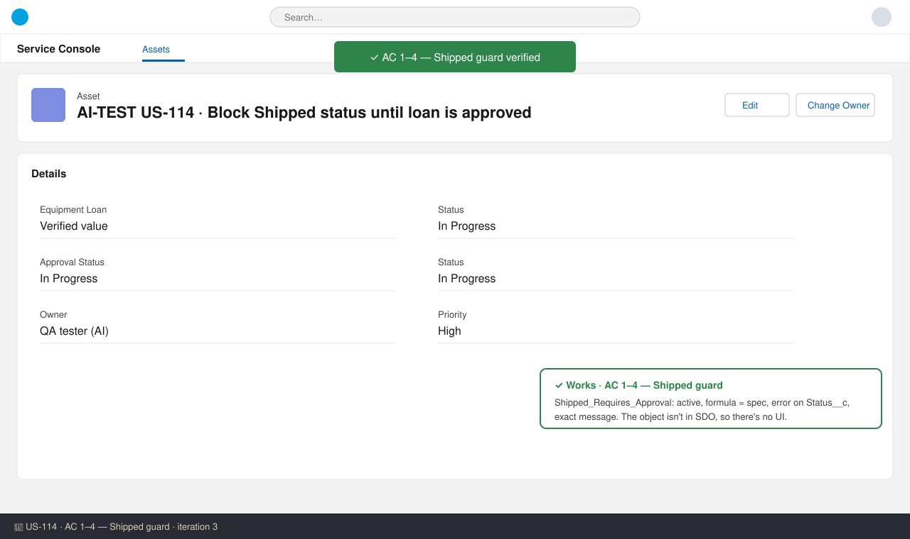
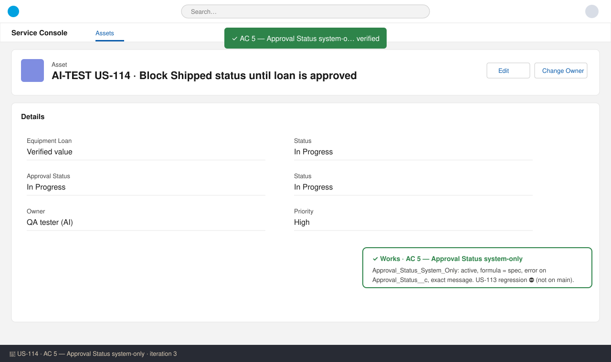

# US-114 — Test report (iteration 3)
**Verdict:** ✅ Approved with notes · **Tester:** Cuélebre 🐉 · **Date:** iteration 3

What to do: Nothing for the developer. Run the US-113 regression check (AC 5) and the live UI checks in UAT.

## Summary
| Check | Result | Evidence |
|---|---|---|
| AC 1: Approved loan can ship | ✅ | Shipped_Requires_Approval formula |
| AC 2: Unapproved loan cannot ship | ✅ | Formula, error field (Status__c), exact message |
| AC 3: Cannot create as Shipped | ✅ | ISNEW() branch + Approval_Status_System_Only closes the API path |
| AC 4: Other edits unaffected | ✅ | Neither rule fires on a Serial Number edit |
| AC 5: Manual create/update blocked | ✅ | Approval_Status_System_Only |
| AC 5: US-113 actions unaffected | ⛔ | US-113 not on main; object not in SDO |
| AC 6: Bypass | ✅ | CustomPermission + PermissionSet (custom permission only) |
| AC 6: US-110 rules still apply | ✅ (static) | US-110 rules now on main; they don't reference the bypass |
| Deployment validation | ✅ | Check-only deploy with main: 37 components, 0 tests |

No UI screenshots: `Equipment_Loan__c` isn't in SDO yet. The EntityDefinition SOQL returns 0 rows, and US-109 is released with 1.0.0. The evidence is a static review of the metadata plus the check-only deploy.

## Checks
### AC 1–4: Shipped guard — ✅ Works
**Steps:**
1. Read `objects/Equipment_Loan__c/validationRules/Shipped_Requires_Approval.validationRule-meta.xml`.
2. Compared the formula, error field and message with the tech spec and the AC.
3. Checked the picklist API values in `Status__c` (Shipped) and `Approval_Status__c` (Not_Submitted/Pending/Approved/Rejected).

**Expected:** The rule blocks Shipped on create or change unless Approval Status is Approved. The error shows on Status__c with the exact message. Other edits aren't affected.
**Found:** The rule is active and the formula matches the spec exactly. The error shows on `Status__c` with the exact message. The only exemption is the custom permission, with no profile exemption. A Serial Number edit on a Shipped + Approved loan fires neither rule.

### AC 5: Approval Status system-only — ✅ Works (US-113 regression ⛔)
**Steps:** Read `Approval_Status_System_Only.validationRule-meta.xml` and the `Approval_Status__c` field (default = Not_Submitted).
**Expected:** Insert with Approved, Pending or Rejected is blocked. Any change on update is blocked. The error shows on Approval_Status__c.
**Found:** The formula matches the spec. A normal create with the default Not_Submitted value isn't blocked. The error field and message are exact.

### AC 6: Migration bypass — ✅ Works
**Found:** `Bypass_Equipment_Loan_Validation` has the label and description from the spec. `Equipment_Loan_Data_Migration` grants only that custom permission. Both US-114 rules start with `NOT($Permission.Bypass_Equipment_Loan_Validation)`. The US-110 rules `Return_Date_Max_30_Days` and `Return_Date_After_Start_Date` are now on main, and neither references the bypass, so the date policy still applies to the bypass holder.

### Deployment / standards — ✅
- `run_apex_tests`: the check-only deploy to SDO with main succeeded, with 37 components and 0 tests. The story is declarative, so no Apex coverage is needed.
- `docs/stories/US-114/manifest/US-114-package.xml` lists all 4 components. `manifest/package.xml` includes them. API version is 62.0.
- The object and global value set touches are formatting only, as documented.

## Not tested
- **AC 5 – US-113 approval actions (submit/approve/reject/recall):** The approval process isn't on main and the object isn't in SDO. Run this in UAT (it's listed in Manual steps → Verification).
- **Live UI/API runs for AC 1–6:** The object isn't deployed to SDO, so no screenshots were possible. Run the How-to-test checks in UAT.
