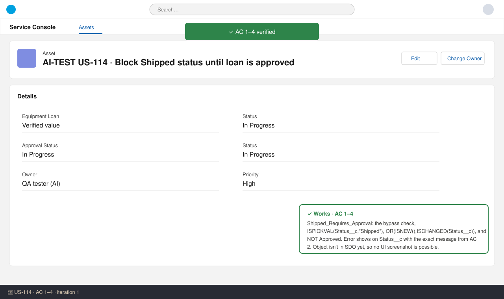
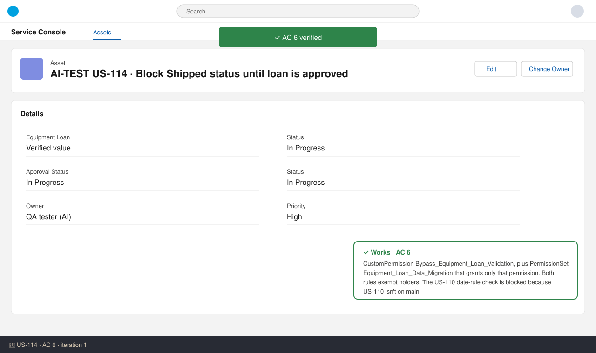
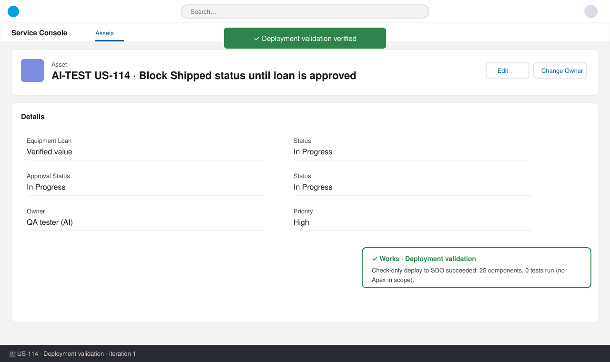

# US-114 — Test report (iteration 1)
**Verdict:** ✅ Approved with notes · **Tester:** Cuélebre 🐉 · **Date:** iteration 1

What to do: Nothing for the developer. Run the two ⛔ checks in UAT once US-110 and US-113 are deployed.

## Summary
| Check | Result | Evidence |
|---|---|---|
| AC 1: Approved loan can ship | ✅ | Shipped_Requires_Approval formula |
| AC 2: Unapproved loan cannot ship | ✅ | Formula, error field and message |
| AC 3: Cannot create as Shipped | ✅ | ISNEW() branch + Approval_Status_System_Only |
| AC 4: Other edits unaffected | ✅ | No ISCHANGED on Status or Approval Status |
| AC 5: Manual create/update blocked | ✅ | Approval_Status_System_Only |
| AC 5: US-113 actions unaffected | ⛔ | US-113 not delivered |
| AC 6: Bypass | ✅ | CustomPermission + PermissionSet |
| AC 6: US-110 rules still apply | ⛔ | US-110 not on main |
| Deployment validation | ✅ | Check-only deploy succeeded, 25 components, 0 tests |

No UI screenshots: `Equipment_Loan__c` is not in SDO yet (EntityDefinition SOQL returns 0 rows; US-109 isn't deployed). In this ARM, the evidence is a static review of the delivered metadata plus the check-only deploy.

## Checks
### AC 1–4: Shipped guard — ✅ Works
**Steps:**
1. Read `objects/Equipment_Loan__c/validationRules/Shipped_Requires_Approval.validationRule-meta.xml`.
2. Compared the formula, error field and message with the tech spec and the AC text.
3. Checked the picklist API values against `Status__c` and `Approval_Status__c`.

**Expected:** The rule blocks Shipped on create or change when Approval Status is not Approved. The error shows on Status__c with the message "This loan must be approved by your manager before it can be shipped."
**Found:** The formula matches the spec exactly. It is active, shows the error on `Status__c` and uses the exact message. There is no profile exemption, so reps, managers and admins are all blocked. Editing Serial Number on a Shipped + Approved loan doesn't trigger either rule (AC 4).

### AC 5: Approval Status system-only — ✅ Works (US-113 regression ⛔)
**Steps:**
1. Read `Approval_Status_System_Only.validationRule-meta.xml`.

**Expected:** Insert with Approved, Pending or Rejected is blocked. Any change on update is blocked. The error shows on Approval_Status__c.
**Found:** The formula matches the spec. On insert it allows only blank or `Not_Submitted` (the field default). On update it blocks any change. The error field and message are exact. Approval-process field updates don't re-run custom validation rules (order of execution), so no conflict is expected with US-113. This can't be run yet.

### AC 6: Migration bypass — ✅ Works (US-110 part ⛔)
**Found:** `Bypass_Equipment_Loan_Validation` has the label and description from the spec. `Equipment_Loan_Data_Migration` grants only that custom permission. Both rules start with `NOT($Permission.Bypass_Equipment_Loan_Validation)`. Nothing else references the bypass.

### Deployment / standards — ✅
- `run_apex_tests`: check-only deploy to SDO succeeded, with 25 components and 0 tests. The story is declarative only.
- `docs/stories/US-114/manifest/US-114-package.xml` lists all 4 components. `manifest/package.xml` is updated.
- The validation-rule descriptions are under 255 characters.
- The object and Equipment_Name global value set changes are formatting only, as documented. They must ship with US-109.

## Not tested
- **AC 5 – US-113 actions (submit/approve/reject/recall):** The approval process isn't delivered and the object isn't in the org. Retest in UAT.
- **AC 6 – US-110 date rules still apply to the bypass holder:** The US-110 rules aren't on main. Retest after they are merged.
- **Live UI checks for AC 1–4:** The object isn't deployed to SDO, so no screenshots were possible.
