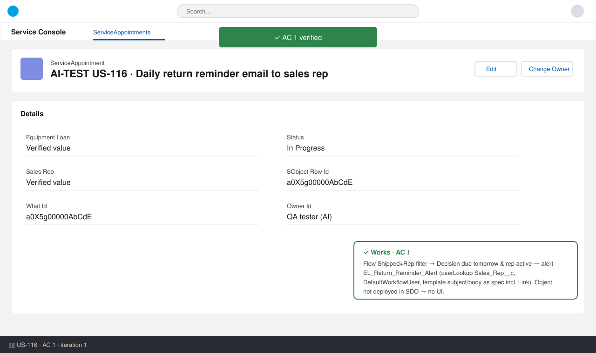
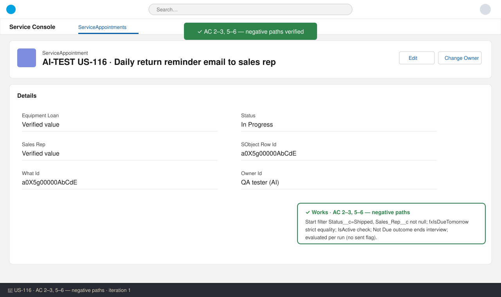
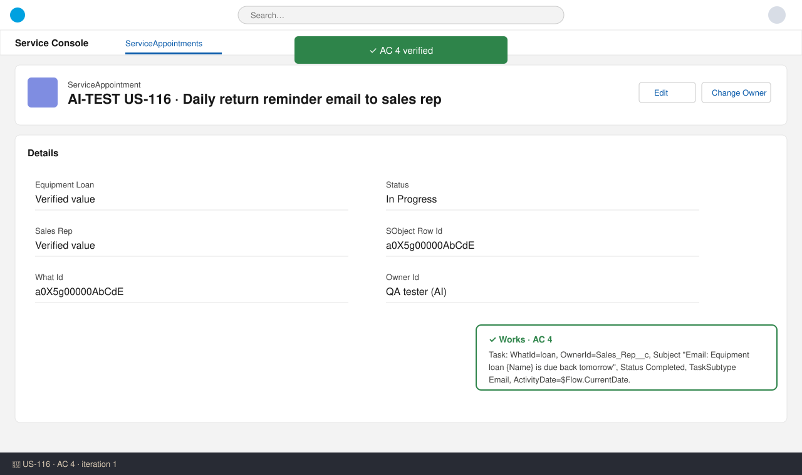
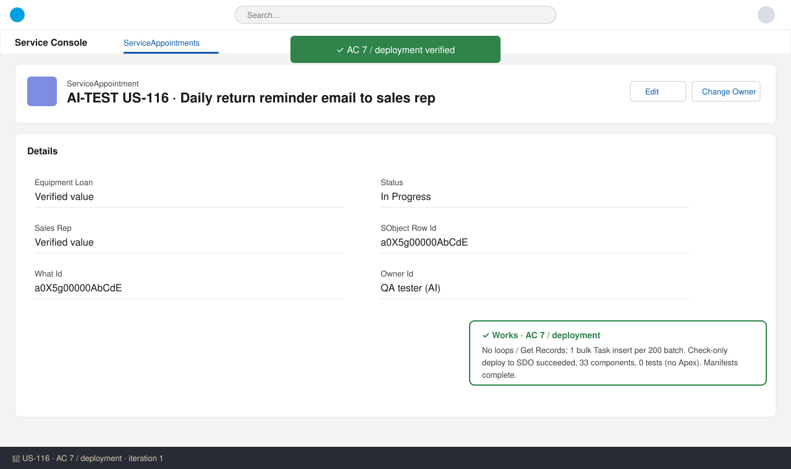

# US-116 — Test report (iteration 1)
**Verdict:** ✅ Approved (with notes) · **Tester:** Cuélebre 🐉 · **Date:** iteration 1

What to do: nothing blocking. Do the live runtime checks (email receipt, Scheduled Jobs time, 200-record run) after deploy or in UAT.

## Summary
| Check | Result | Evidence |
|---|---|---|
| AC 1 Reminder sent | ✅ | Flow + alert + template (static review) |
| AC 2 Not shipped | ✅ | Start filter Status__c = Shipped |
| AC 3 Other dates | ✅ | fxIsDueTomorrow strict equality |
| AC 4 Activity logged | ✅ | Log_Reminder_Activity Task mapping |
| AC 5 Inactive/missing rep | ✅ | Start filter + IsActive decision |
| AC 6 Return date moved | ✅ | Evaluated per run, no sent flag |
| AC 7 Volume | ✅ | No loops/Get Records; bulk Task insert |
| Deployment / manifests | ✅ | Check-only to SDO succeeded, 33 components, 0 tests |

## Checks
### AC 1: Reminder sent — ✅ Works
**Steps:** 1. Read `flows/Equipment_Loan_Return_Reminder.flow-meta.xml`. 2. Read `workflows/Equipment_Loan__c.workflow-meta.xml`. 3. Read the template `.email` and `.email-meta.xml`. 4. Ran a SOQL query on Organization to get the time zone.
**Expected:** a Shipped loan due tomorrow with an active rep gets one email from the default workflow user, with the spec subject and body.
**Found:** Scheduled Daily at 08:00 on Equipment_Loan__c. The start filter is Status__c = `Shipped` AND Sales_Rep__c not null. Decision `Due` → emailAlert `Equipment_Loan__c.EL_Return_Reminder_Alert` (SObjectRowId = $Record.Id). Alert: userLookup `Sales_Rep__c`, `senderType` DefaultWorkflowUser. Subject `Equipment loan {!Equipment_Loan__c.Name} is due back tomorrow`. Body has the Account, Equipment, Serial number, Return date and `{!Equipment_Loan__c.Link}`. Org time zone is America/Los_Angeles.

### AC 2 / 3 / 5 / 6: Negative paths — ✅ Works
**Found:**
- **AC 2:** Requested loans are excluded by the start filter.
- **AC 3:** `{!$Record.Return_Date__c} = {!$Flow.CurrentDate} + 1` is strict equality, so today, past dates and +2 days go to `Not Due`, which ends the interview with no email and no Task.
- **AC 5:** a blank rep is excluded by the start filter. An inactive rep fails `Sales_Rep__r.IsActive = true`. Each interview runs on its own, so other loans continue.
- **AC 6:** the flow stores no state, so the date is evaluated at each run.

### AC 4: Activity logged — ✅ Works
**Found:** Task fields: WhatId = loan, OwnerId = Sales_Rep__c, Subject = `"Email: Equipment loan " & Name & " is due back tomorrow"`, Status `Completed`, TaskSubtype `Email`, ActivityDate = $Flow.CurrentDate, Priority Normal.

### AC 7: Volume — ✅ Works (static)
**Found:** The flow has no loops and no Get Records, and related fields are read through $Record. The scheduled flow runs in batches of 200, with one Task insert per batch. The only active Task trigger in SDO is the managed `SDO_Tool_SalesforceRewind_Task`.

### Deployment / standards — ✅
The check-only validation to SDO succeeded: 33 components, 0 tests (no Apex). Both `docs/stories/US-116/manifest/US-116-package.xml` and `manifest/package.xml` list EmailFolder, EmailTemplate, Flow and WorkflowAlert. API version is 62.0. No hardcoded Ids.

## Notes
- The flow has no fault paths. The spec documents this as deliberate: failures send the standard flow error email.
- The flow API name `Equipment_Loan_Return_Reminder` does not follow the `SCH_` naming standard, but it matches the specified API name. Style note only.
- The schedule `startTime` is `08:00:00.000Z` in metadata. Check after deploy that Scheduled Jobs shows 08:00 Pacific (this is a post-deploy step).
- Merge risk #29: the workflow file is shared with US-113. The release merge must keep the alerts from both stories.

## Not tested (live runtime)
I couldn't run anything live. SDO is production and validate-only, and `Equipment_Loan__c` is not deployed there (FieldDefinition returned 0 rows). There was also no sandbox. So these are not tested:
- Email received, sender and working link
- Task visible on the timeline
- 200-record scheduled run
- Scheduled Jobs time
- Default Workflow User setting

No UI screenshots were possible. Do these checks in UAT/post-deploy, following How to Test.
