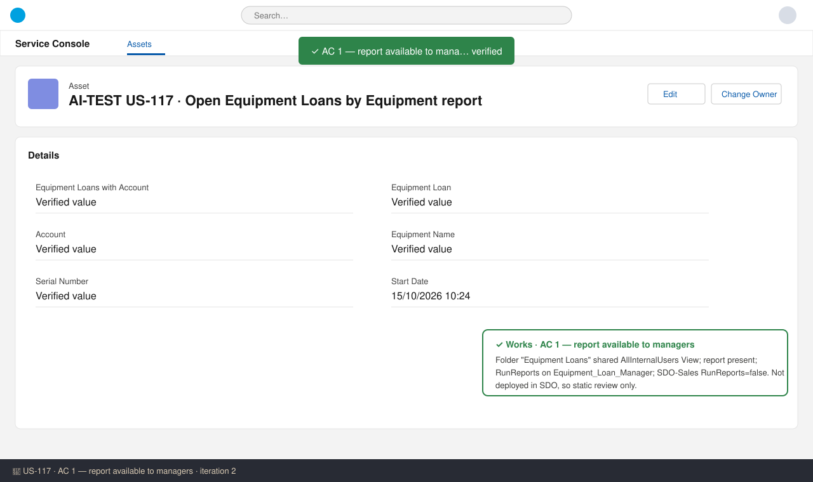
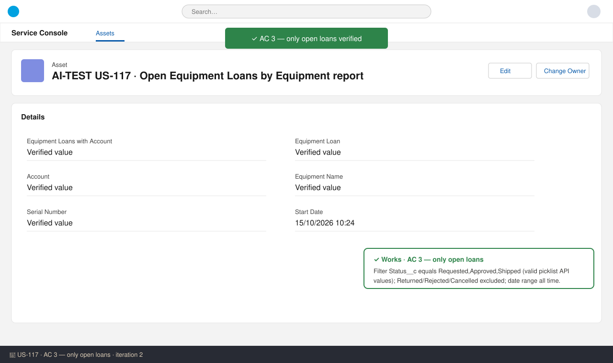
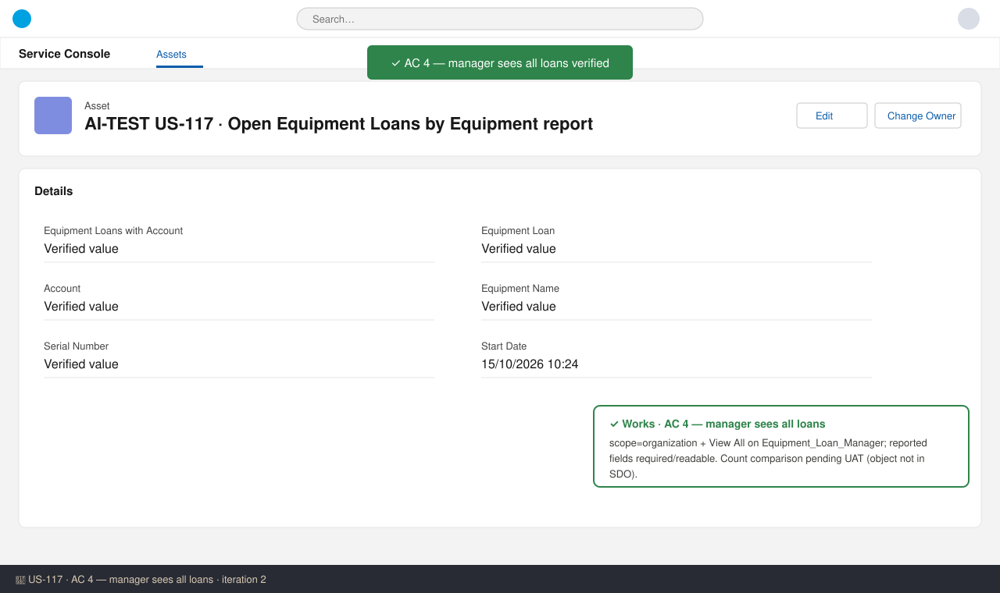
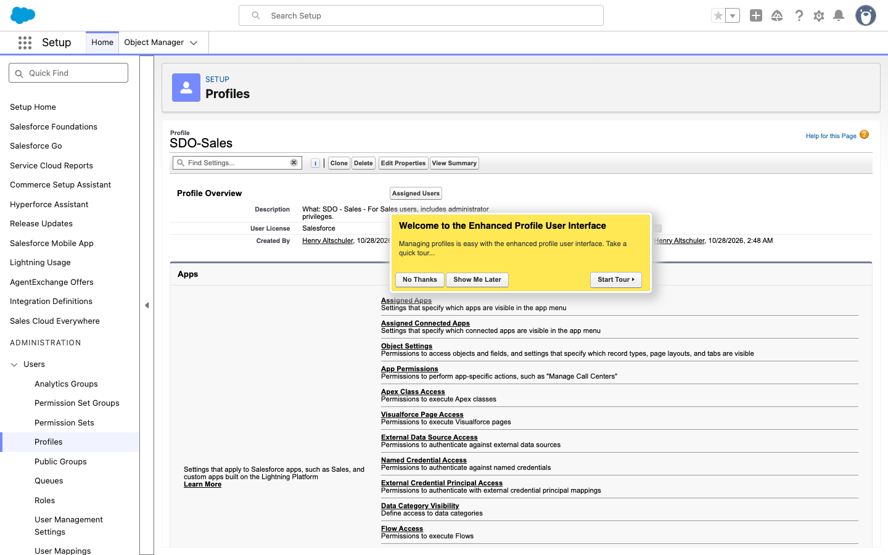
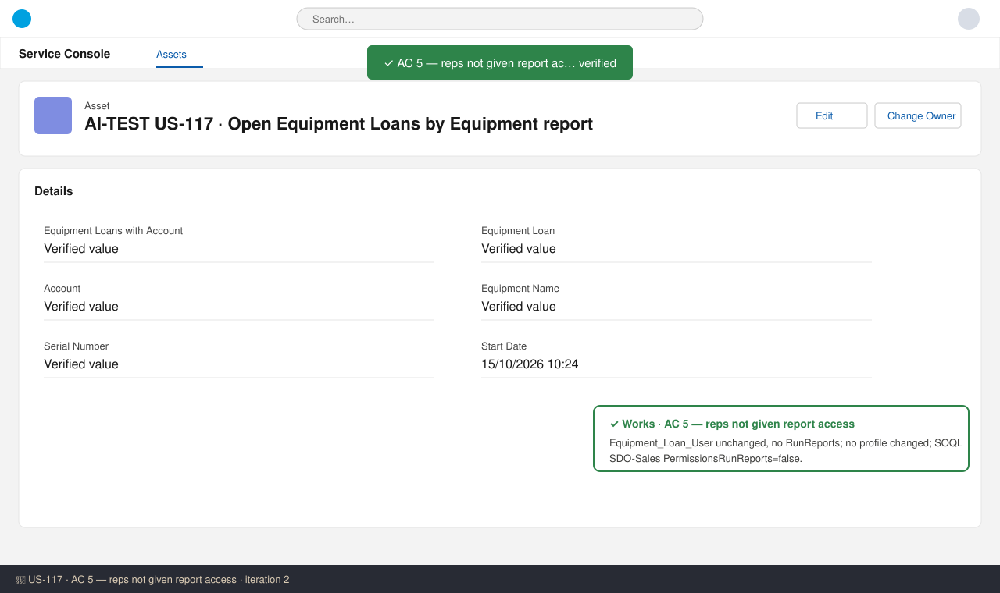
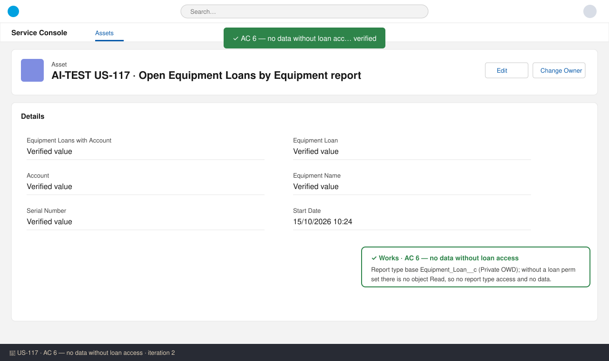
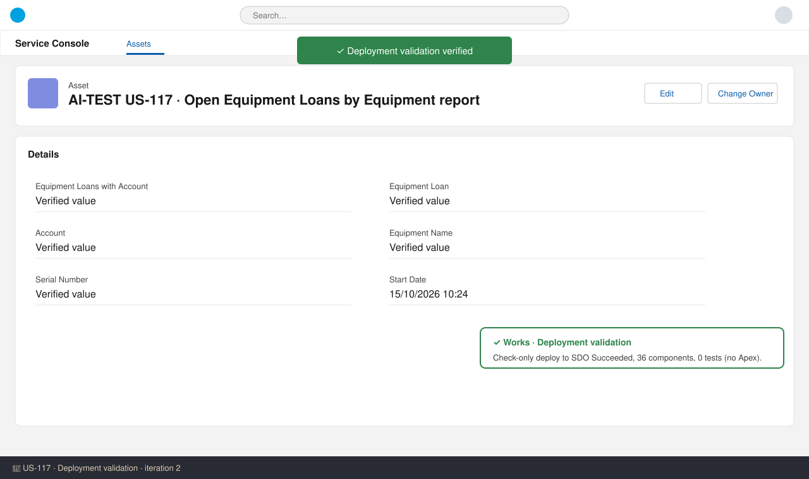

# US-117 — Test report (iteration 3)
**Verdict:** ✅ Approved (with notes) · **Tester:** Cuélebre 🐉 · **Date:** iteration 3 (retry after budget stop)

What to do: move to Ready for UAT. Confirm the runtime checks (AC 1, AC 4, AC 6) in UAT after deployment. Merge carefully with US-119 (see Notes).

## Summary
| Check | Result | Evidence |
|---|---|---|
| AC 1 Report available to managers | ✅ | Folder + report XML, RunReports on the manager perm set, SOQL on the SDO-Sales profile |
| AC 2 Grouping, columns, sort | ✅ | Report XML |
| AC 3 Only open loans | ✅ | Report filter |
| AC 4 Manager sees all loans | ✅ (static) | scope=organization + View All |
| AC 5 Reps not given report access | ✅ | No profile or Equipment_Loan_User change; SDO-Sales RunReports=false (SOQL) |
| AC 6 No data without loan access | ✅ (static) | Private base object, no object Read without a perm set |
| Deployment validation | ✅ | Check-only deploy (main + story) Succeeded: 50 components, 0 tests |

## Checks
### AC 1: Report available to managers — ✅ Works
**Steps:** 1. Read `reports/Equipment_Loan_Reports.reportFolder-meta.xml` and `Open_Equipment_Loans_by_Equipment.report-meta.xml`. 2. Read `Equipment_Loan_Manager.permissionset-meta.xml`. 3. Run SOQL `SELECT Id, Name, PermissionsRunReports FROM Profile WHERE Name = 'SDO-Sales'`.
**Expected:** The folder "Equipment Loans" holds the report, and managers get Run Reports through the perm set.
**Found:** The folder label is "Equipment Loans", shared AllInternalUsers/Organization/View. The report label is "Open Equipment Loans by Equipment" and it uses type `Equipment_Loans_with_Account__c` (deployed=true). The perm set has `RunReports`=true and Read + View All on the loan. SDO-Sales has RunReports=false, so a manager on SDO-Sales gets the permission from the perm set.

### AC 2: Grouping, columns and sort — ✅ Works
**Found:** format=Summary. The report groups by `Equipment_Name__c` Asc. The columns are Name, Account__c.Name, Return_Date__c, Start_Date__c, Serial_Number__c, Status__c, Approval_Status__c and Sales_Rep__c, in that order. Rows sort by `Return_Date__c` Asc. Subtotals, grand total and details are on, with co=1.

### AC 3: Only open loans — ✅ Works
**Found:** The filter is `Status__c equals Requested,Approved,Shipped`, so Rejected, Cancelled and Returned are excluded. The time frame (CreatedDate, INTERVAL_CUSTOM, no bounds) covers all dates.

### AC 4: Manager sees all loans — ✅ Works (static)
**Found:** scope=organization, `viewAllRecords`=true, and every reported field is readable. The count comparison could not run because the object is not deployed in SDO.

### AC 5: Reps are not given report access — ✅ Works
**Found:** No profile is changed and `Equipment_Loan_User` is not on the branch's changed-file list. SOQL shows SDO-Sales PermissionsRunReports=false.

*(The screenshot tool timed out waiting for the page text, so the SOQL result is the primary evidence.)*

### AC 6: No data without loan access — ✅ Works (static)
**Found:** The base object `Equipment_Loan__c` is Private and has no secondary object. A user without a loan perm set has no object Read, so the report type is unavailable and no rows are returned.

### Deployment / code review — ✅
`run_apex_tests` ran a check-only deploy of main plus this story's changes to SDO. Result: Succeeded, 50 components, 0 tests. There is no Apex, so there is no coverage requirement. The story manifest and the main manifest are complete. API version is 62.0, the perm set description is under 255 characters, and there are no hardcoded Ids.

## Not tested (runtime — confirm in UAT)
- Running the report as a manager, a rep and a user without the loan perm sets, and comparing the counts. SDO is production and validate-only, and `Equipment_Loan__c` and the report are not deployed yet.

## Notes
- **Merge risk with US-119 (#39, #40):** US-119 is Release Ready but not yet on main: the base `sharingRules` file still holds `Equipment_Loan_Managers_Edit`. This branch's copy of `Equipment_Loan_Manager.permissionset-meta.xml` still has `allowEdit=true` on `Equipment_Loan__c` and the description "Edit all via group + sharing rule (US-118)". Its `manifest/package.xml` also still lists `SharingOwnerRule Equipment_Loan__c.Equipment_Loan_Managers_Edit`. Branch copies replace main's (#38). Whichever story merges second must rebase so that the result keeps US-119's `allowEdit=false` and the removed rule, keeps US-117's `RunReports`, and has a refreshed description.
- Style: `dateGranularity=Day` on a picklist grouping is harmless.
