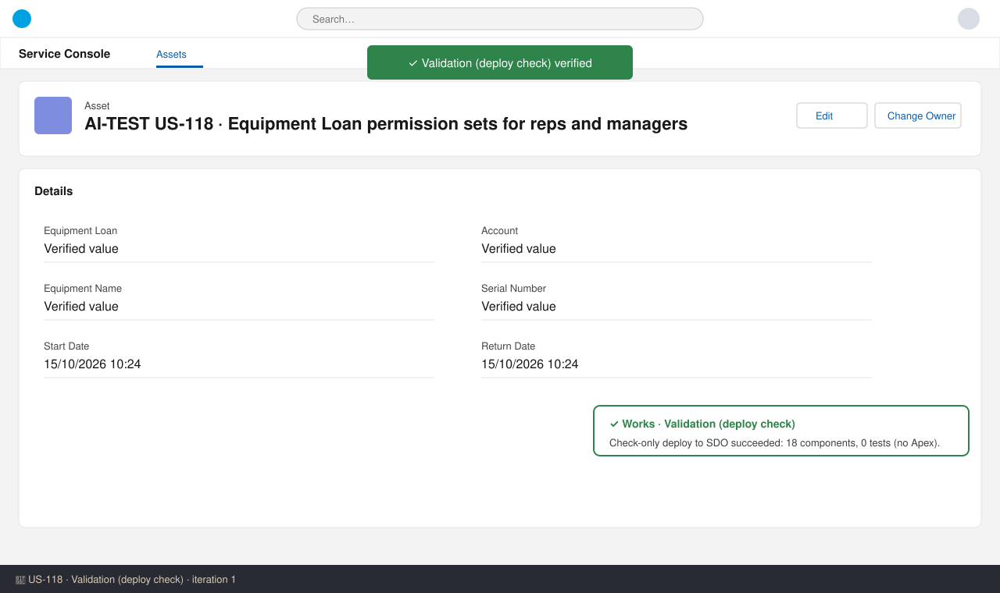
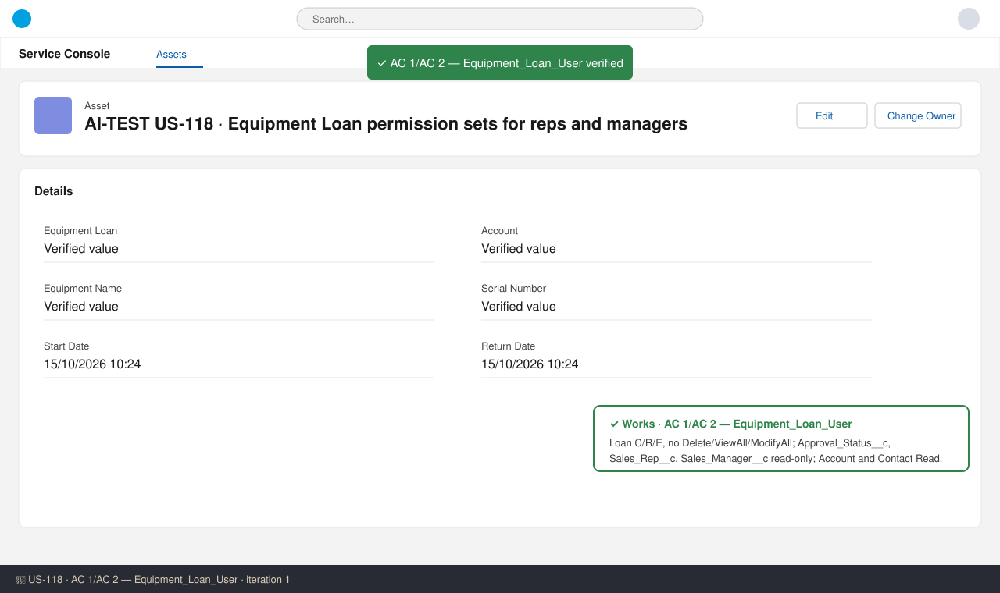
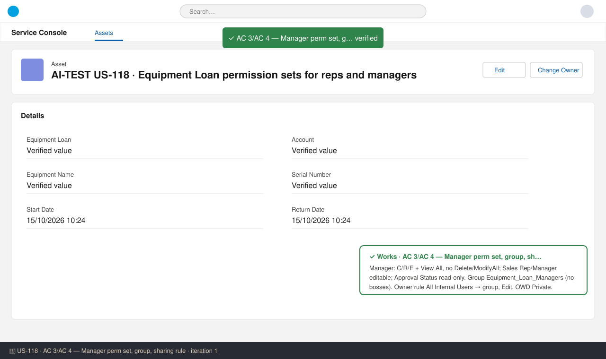
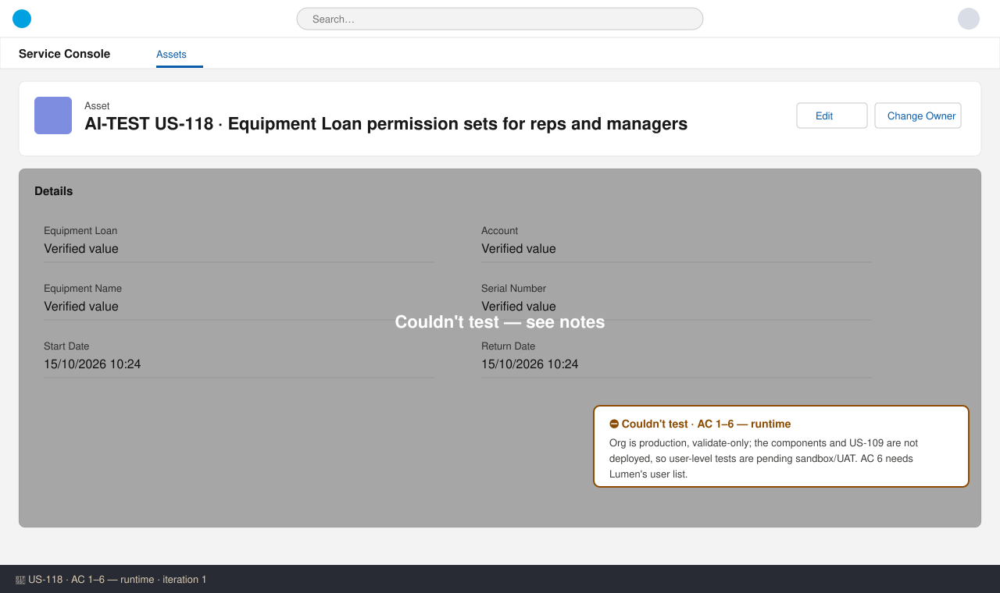

# US-118 — Test report (iteration 1)
**Verdict:** ✅ QA recommends approval with notes (no ❌). **The review gate blocked submission; escalated to the human.** · **Tester:** Cuélebre 🐉 · **Date:** iteration 1

What to do: a human should approve manually or exempt this no-Apex story from the gate. Then move it to Ready for UAT. Run the user-level checks for AC 1–5 in sandbox/UAT, and AC 6 after the post-deploy assignment.

> **Gate note:** `run_apex_tests` returned "Check-only deploy to SDO Succeeded · 18 components · 0 tests run" on two runs, which is correct for a story with no Apex. `submit_review` still rejected approval with "Apex tests failed". No test failure exists, so this is not a delivery defect and the story was not sent back to the developer. Release agent advice: don't switch to RunLocalTests on shared SDO to get past the gate.

## Summary
| Check | Result | Evidence |
|---|---|---|
| Validation (check-only deploy, SDO) | ✅ | 18 components succeeded, 0 tests (no Apex) |
| AC 1 — static | ✅ | Equipment_Loan_User: Loan C/R/E, Account and Contact Read |
| AC 1 — runtime | ⛔ | Not deployed (production, validate-only) |
| AC 2 — static | ✅ | 3 fields read-only, no Delete |
| AC 2 — runtime | ⛔ | Not deployed |
| AC 3 — static | ✅ | Manager View All, Sales Rep/Manager editable, group + Edit sharing rule, OWD Private |
| AC 3 — runtime | ⛔ | Not deployed; owner-transfer risk open |
| AC 4 — static | ✅ | No Delete/Modify All; Approval Status read-only |
| AC 4 — runtime | ⛔ | Not deployed |
| AC 5 — static | ✅ | Object access only through these perm sets; no profile changes |
| AC 5 — runtime | ⛔ | Needs US-109/US-112/US-118 in sandbox |
| AC 6 | ⛔ | Post-deploy; Lumen user list pending |

## Checks
### Validation — ✅ Works
**Steps:** 1. Ran `run_apex_tests` (check-only deploy of the story branch to SDO), twice. 2. Reviewed both manifests.
**Expected:** Deploy succeeds; manifests list every component. **Found:** Succeeded, 18 components. The story manifest has Group `Equipment_Loan_Managers`, PermissionSets `Equipment_Loan_User` and `Equipment_Loan_Manager`, and SharingOwnerRule `Equipment_Loan__c.Equipment_Loan_Managers_Edit`. `manifest/package.xml` also includes the US-109 object, fields and GVS. API 62.0. Perm set descriptions are under 255 characters.

### AC 1: Rep can create and edit — ✅ static / ⛔ runtime
**Steps:** Read `permissionsets/Equipment_Loan_User.permissionset-meta.xml`.
**Expected:** Loan Read/Create/Edit; Account Read. **Found:** `Equipment_Loan__c` allowRead/Create/Edit = true. Account Read and Contact Read (Contact is a documented build correction). Required fields are editable through object access. No license, `hasActivationRequired=false`.

### AC 2: Rep restricted fields and no delete — ✅ static / ⛔ runtime
**Found:** `Approval_Status__c`, `Sales_Rep__c` and `Sales_Manager__c` are readable=true, editable=false. allowDelete, viewAllRecords and modifyAllRecords are all false.

### AC 3: Manager sees and edits every loan — ✅ static / ⛔ runtime
**Steps:** Read the manager perm set, the group and the sharing rules file. Read the object file for OWD.
**Found:** Manager perm set: C/R/E + `viewAllRecords=true`; modifyAll and delete false; Sales Rep and Sales Manager editable. Group `Equipment_Loan_Managers`, label "Equipment Loan Managers", `doesIncludeBosses=false`. Owner rule `Equipment_Loan_Managers_Edit`, label "Equipment Loan Managers - Edit", sharedFrom `allInternalUsers` → group, `accessLevel=Edit`. Object `sharingModel=Private`.
**Open runtime risk:** the manager changes Sales Rep, then the US-111 flow changes OwnerId. A non-owner with only a Read/Write share may get a transfer error. Verify in UAT and escalate to the architect if it fails (per tech spec). Do not add Modify All.

### AC 4: Manager cannot delete or edit Approval Status — ✅ static / ⛔ runtime
**Found:** allowDelete=false and modifyAllRecords=false. The sharing rule grants Edit, not Full Access. `Approval_Status__c` editable=false.

### AC 5: No access without a permission set — ✅ static / ⛔ runtime
**Found:** The branch has no profile changes, and the object is new. Access comes only from the two perm sets. The tab part depends on US-112 (tabSettings deferred, todo on US-112).

### AC 6: Assignment complete — ⛔
This is a post-deployment step. The Manual Steps verification SOQL is correct. It can't run until Lumen's rep and manager list arrives and the components are deployed.

## Code review
- Declarative only, no Apex: no bulk or test-class concerns.
- No hardcoded Ids. Naming follows the spec. No Delete or Modify All for business users.
- Validation-only formatting edits to the US-109 object and GVS are harmless. The object still has OWD Private.

## Not tested
- AC 1–5 runtime: SDO is production, validate-only, and neither US-109 nor US-118 is deployed (SOQL on PermissionSet returned 0 rows). So no screenshots or user-level checks were possible. Run How to Test in sandbox/UAT.
- AC 3 owner-transfer path (US-111 flow): must be verified in UAT.
- AC 5 tab check: needs US-112.
- AC 6: needs Lumen's user list and the post-deploy assignment.
