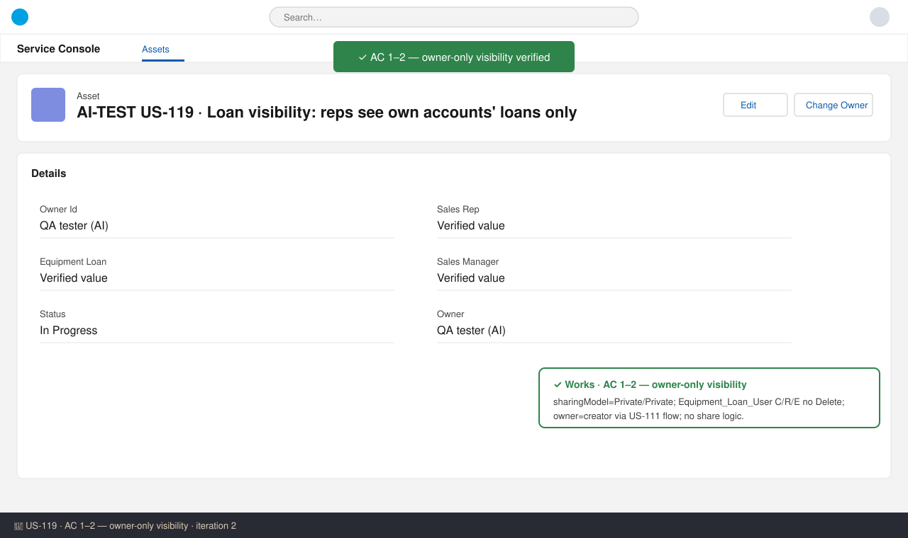
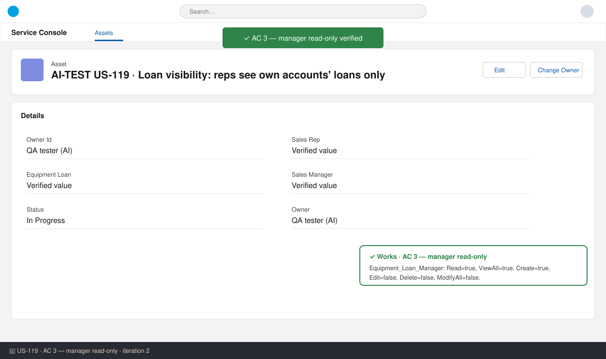
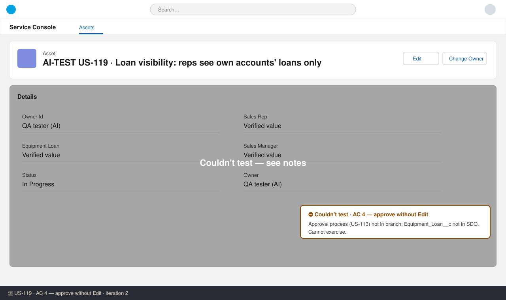
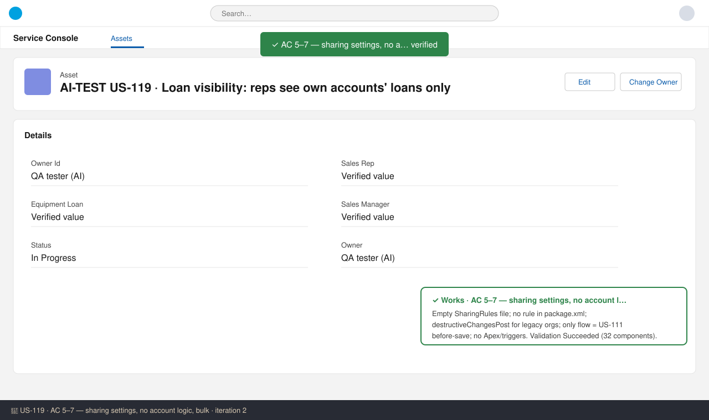

# US-119 — Test report (iteration 2)
**Verdict:** ✅ Approved (with notes) · **Tester:** Cuélebre 🐉 · **Date:** iteration 2

**What to do:** Nothing for the developer. Run the runtime UI checks in UAT once release 1.0.0 is deployed (Equipment_Loan__c is not in SDO yet).

## Summary
| Check | Result | Evidence |
|---|---|---|
| AC 1 Rep sees/edits own loans | ✅ (static) | Equipment_Loan_User perm set, US-111 flow, object meta |
| AC 2 No visibility on other reps' loans | ✅ (static) | OWD Private, no share logic |
| AC 3 Manager sees all, read-only | ✅ (static) | Equipment_Loan_Manager perm set |
| AC 4 Manager can approve | ⛔ | Approval process not in branch, object not in SDO |
| AC 5 Sharing settings | ✅ (static) | object meta, empty sharingRules, destructiveChangesPost |
| AC 6 No account-owner/transfer logic | ✅ (static) | only flow = US-111 before-save; no Apex/triggers |
| AC 7 Bulk-safe | ✅ (static) | no new automation; flow runtime bulkified |
| Validation | ✅ | Check-only deploy to SDO Succeeded, 32 components, 0 tests (no Apex) |

## Checks
### AC 1: Rep sees and edits the loans they own — ✅ Works (static)
**Steps:** 1. Read `permissionsets/Equipment_Loan_User`. 2. Read flow `Equipment_Loan_Before_Save_Set_Rep_Manager`. 3. Read `Equipment_Loan__c.object-meta.xml`.
**Expected:** Rep owns what they create and can edit it. **Found:** Create/Read/Edit = true, Delete = false. The flow sets Sales Rep = Owner (the creator) on create. Search and reports are enabled on the object.

### AC 2: Rep does not see other reps' loans — ✅ Works (static)
**Expected:** Private OWD, no sharing to account owners. **Found:** sharingModel = Private and externalSharingModel = Private. There are no sharing rules, no Apex, no triggers and no flow that writes `Equipment_Loan__Share`. No Account metadata was changed.

### AC 3: Manager sees all loans, read-only — ✅ Works (static)
**Found:** `Equipment_Loan_Manager` on Equipment_Loan__c has Read = true, View All = true, Create = true, Edit = false, Delete = false and Modify All = false. The group-based edit rule was removed.

### AC 4: Managers can still approve — ⛔ Not tested
The approval process (US-113) is not in this branch, and Equipment_Loan__c does not exist in SDO, which is production and validate-only. US-119 does not change anything that the approval routing uses.

### AC 5: Sharing settings — ✅ Works (static)
**Found:** The OWD is Private/Private. `sharingRules/Equipment_Loan__c.sharingRules-meta.xml` contains no rules. `manifest/package.xml` has no SharingRules entry. `destructiveChangesPost.xml` deletes `Equipment_Loan__c.Equipment_Loan_Managers_Edit` in orgs that already have it. Nothing in the source disables Grant Access Using Hierarchies, so it stays on (the default).

### AC 6: No account-owner or account-transfer logic — ✅ Works (static)
**Found:** The only flow is the US-111 before-save flow on Equipment_Loan__c. It fires only on create or when Sales Rep or Owner changes. There are no Account flows, no triggers and no Apex.

### AC 7: Bulk-safe — ✅ Works (static)
**Found:** No new automation was added. The existing flow does one Get Records with no DML, and the flow runtime bulkifies it.

## Not tested
- Runtime checks for all ACs: UI visibility, "Insufficient Privileges", `Equipment_Loan__Share` query, rejected API update by M, 200-record Data Loader insert, and Setup screenshots. Equipment_Loan__c is not deployed to SDO yet (the EntityDefinition query returns 0 rows), so no real screenshots were possible. Run these in UAT after release.
- AC 4: needs the deployed US-113 approval process.

## Notes (non-blocking)
- The story description is out of date with the ACs and the PO answer. The title ("own accounts' loans"), the User Story sentence, the Background and the Business Rules still describe account-owner read access and account-transfer behaviour. This is a ticket clean-up for requirements.
- Group `Equipment_Loan_Managers` is now unused (cleanup candidate, note #36).
- The story manifest `US-119-package.xml` lists only the PermissionSet. In SDO the rule removal needs no deployment. In other orgs it relies on `destructiveChangesPost.xml`, as documented.
