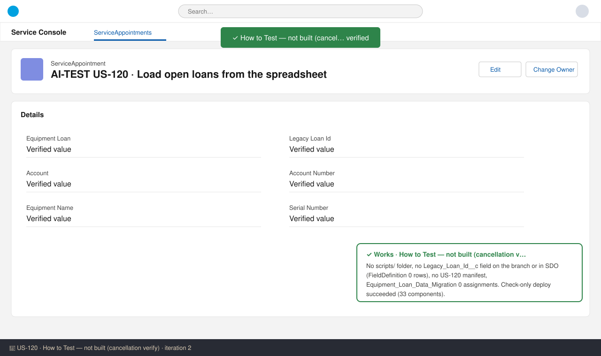

# US-120 — Test report (iteration 2)
**Verdict:** ✅ Approved with notes (story cancelled, nothing delivered) · **Tester:** Cuélebre 🐉 · **Date:** current iteration

**What to do:** Close US-120 as **Cancelled**. Do not move it to UAT and do not add it to release 1.0.0 (PO decision, note #32).

## Summary
| Check | Result | Evidence |
|---|---|---|
| How to Test: confirm nothing was built | ✅ | Branch + SOQL |
| Deployment validation (check-only, SDO) | ✅ | Succeeded, 33 components, 0 tests |
| AC 1 – AC 7 | ⛔ | Story cancelled by PO, nothing to test |

## Checks
### How to Test: cancellation verify — ✅ Works
**Steps:**
1. `list_files scripts/`: empty.
2. `list_files force-app/main/default/objects/Equipment_Loan__c/fields/`: 10 fields, none is `Legacy_Loan_Id__c`.
3. `list_files manifest/`: only `package.xml`, no US-120 manifest.
4. SOQL `FieldDefinition` for `Equipment_Loan__c.Legacy_Loan_Id__c` in SDO: 0 rows.
5. SOQL `PermissionSetAssignment WHERE PermissionSet.Name = 'Equipment_Loan_Data_Migration'`: 0 rows.

**Expected:** no field, no `scripts/data/us120/`, permission set not assigned for a migration. **Found:** exactly that.

### Deployment validation — ✅ Works
Check-only deploy of main plus this branch (0 changes) to SDO succeeded with 33 components. The project has no Apex, so 0 tests ran.

## Not tested
- **AC 1 – AC 7** (reconciliation, account/rep, date rule, status mapping, reminders, re-runnable load, bypass removed): ⛔ blocked. The PO cancelled the story twice ("Do not build this story"), so no load exists to check. This is a ticket/scope decision, not a delivery defect. Screenshots don't apply because nothing visible was delivered.
